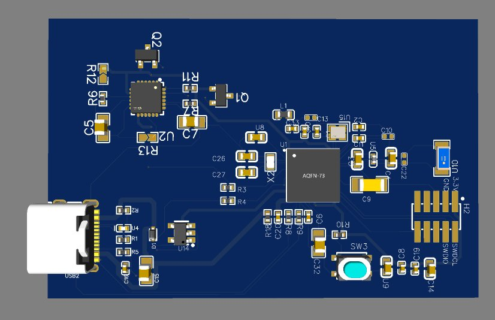
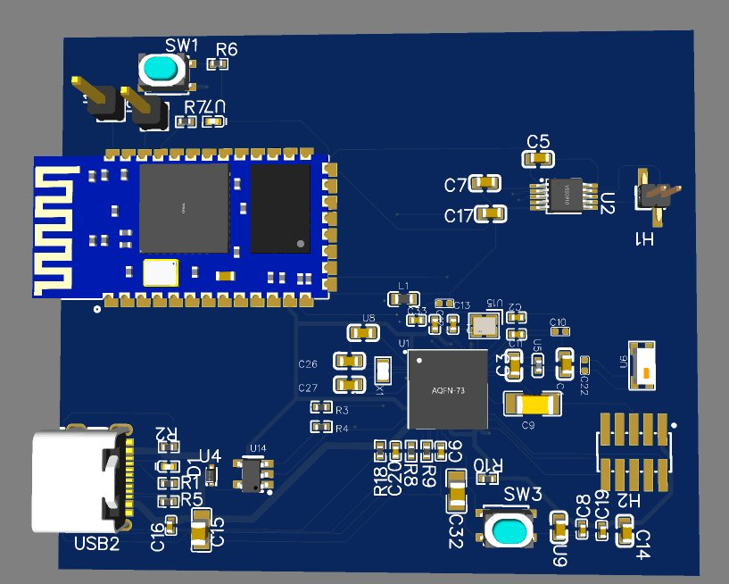

# nRF52840 Motion-to-Haptic Feedback System

- Real-time system that captures hand movement and turns it into physical haptic feedback
- Two independent nRF52840 boards connected over BLE
- **Motion-sensing unit:** reads an IMU and streams the data
- **Haptic feedback unit:** drives a vibration motor from the incoming data
- Project page: [nRF Motion-to-Haptic Feedback System](https://digitalmonk.biz/nrf-motion-haptic-feedback-system/)

## Key Features

- 100 Hz motion streaming over a custom BLE GATT notify characteristic
- Noise-filtered roll and pitch from a complementary filter with gyro bias calibration
- Tilt-to-intensity mapping with deadband, minimum start duty and smoothing
- 20 kHz PWM motor drive, silent to the ear
- Failsafe: motor switches off if data stops or the link drops
- Packet-loss counting from sequence numbers
- Two custom PCBs around the nRF52840 (AQFN-73)

## Hardware

**Motion-sensing unit PCB**



**Haptic feedback unit PCB**



---

## The Challenge

- Low-latency BLE communication between the two devices
- Accurate, noise-filtered IMU processing without added delay
- Drift-free mapping of orientation and movement to haptic output
- Stable, repeatable motor control under varying load and power states

## How It Works

- The motion unit reads the IMU at a fixed rate and filters the noise
- Roll and pitch are sent to the haptic unit as a compact BLE notification
- The haptic unit maps the tilt to a motor intensity and drives the motor
- If data stops or the link drops, the motor switches off

```
 ┌──────────────────────┐        BLE notify        ┌──────────────────────┐
 │  Motion unit         │  ───────────────────▶   │  Haptic unit         │
 │  nRF52840 + IMU      │   8-byte packet @100 Hz  │  nRF52840 + driver   │
 │  (BLE peripheral)    │                          │  (BLE central)       │
 └──────────────────────┘                          └──────────┬───────────┘
        IMU → filter → packet                                  │ PWM
                                                         vibration motor
```

## Components Used

- nRF52840 SoC (AQFN-73) x 2, one per unit
- IMU x 1 (MPU6050 in the reference firmware), motion unit, I2C
- Vibration (haptic) motor x 1, haptic unit
- Custom motor driver circuitry (MOSFET / driver IC) x 1, haptic unit
- Custom PCBs x 2, one per unit
- USB-C connector x 2, for power and programming
- SWD debug header x 2, for flashing and debugging
- Crystals, passives and push buttons, see the schematic / BOM

## Why the nRF52840

- Built-in Bluetooth 5 radio, so no external BLE module is needed
- Cortex-M4F with a hardware FPU, which suits the floating-point sensor filtering
- Hardware PWM that runs without CPU load
- Low-power design that fits a battery-powered motion unit
- Supported by the nRF Connect SDK (Zephyr), with a full debug toolchain over SWD

## Motion Unit Firmware

- Runs as a BLE peripheral
- Main loop runs at a fixed 100 Hz, using absolute-time sleeps so jitter does not build up
- **Gyro calibration at boot:** about 200 samples are averaged while the unit is still, and subtracted as a bias
- **Complementary filter:** the gyro gives fast response and the accelerometer pulls the angle back, so roll and pitch do not drift
- **No blocking:** if the BLE stack is out of buffers, the sample is dropped instead of stalling the loop
- Yaw is sent only as a rate, because a true yaw angle needs a magnetometer

## BLE Link

- One custom GATT service with a single notify characteristic
- 8 bytes per packet, little-endian
- Packet fields:
  - `seq` (`uint16`): packet counter, used to count lost packets
  - `roll_cdeg` (`int16`): roll in centi-degrees
  - `pitch_cdeg` (`int16`): pitch in centi-degrees
  - `gyro_z_cdps` (`int16`): yaw rate in centi-degrees per second
- Connection interval requested: 7.5 to 15 ms, no slave latency, 4 s supervision timeout
- The haptic unit finds the motion unit by its service UUID, so no addresses are hard-coded
- The packet definition lives in one shared header: [`common/motion_protocol.h`](common/motion_protocol.h)

## Haptic Unit Firmware

- Runs as a BLE central: scans, connects, discovers the service and subscribes to notifications
- **Deadband:** tilts smaller than 3° are ignored
- **Full scale:** 45° tilt gives 100 % duty
- **Minimum start duty:** 25 %, because many ERM motors will not spin below this
- **Smoothing:** one-pole low-pass on the motor duty
- **PWM frequency:** 20 kHz, above the audible range
- **Failsafe:** motor off after 200 ms without data, and on disconnect
- Lost packets are counted from the sequence numbers and logged

## PCB Design

- Two custom boards, one for each unit
- Both use an nRF52840 in the AQFN-73 package
- USB-C for power and programming
- SWD header for flashing and debugging
- The motor driver stage supplies the motor current, because the nRF52840 GPIO only provides the control signal

## Repository Structure

```
.
├── common/
│   └── motion_protocol.h      # shared UUIDs and packet format
├── motion_unit/               # BLE peripheral: IMU -> filter -> notify
│   ├── boards/
│   │   └── nrf52840dk_nrf52840.overlay
│   ├── src/main.c
│   ├── prj.conf
│   └── CMakeLists.txt
├── haptic_unit/               # BLE central: subscribe -> PWM motor
│   ├── src/main.c
│   ├── prj.conf
│   └── CMakeLists.txt
└── docs/               # PCB renders
```

## Getting Started

**Requirements**
- nRF Connect SDK v2.7+ (Zephyr 3.7+); for older SDKs the board name is `nrf52840dk_nrf52840`
- Two nRF52840 boards (nRF52840 DK or the custom PCBs)
- An MPU6050 breakout for the motion unit

**Build and flash**

```bash
# Motion unit
west build -b nrf52840dk/nrf52840 motion_unit -d build_motion
west flash -d build_motion

# Haptic unit (flash the second board)
west build -b nrf52840dk/nrf52840 haptic_unit -d build_haptic
west flash -d build_haptic
```

**Wiring (nRF52840 DK)**
- Motion unit: MPU6050 SDA to P0.26, SCL to P0.27, VCC to 3.3 V, GND to GND
- Haptic unit: motor PWM on P0.13 (LED1, `pwm_led0` alias)
- For a real motor, drive a MOSFET or driver IC with a flyback diode from the PWM pin
- Never connect a motor directly to the GPIO
- On a custom board, remap the alias in a board overlay and use normal (non-inverted) PWM polarity

**Using it**
- Power the haptic unit, then the motion unit
- Keep the motion unit still for about 2 seconds while the gyro calibrates
- The haptic unit connects automatically and subscribes
- Tilt the motion unit: the motor gets stronger as the tilt increases

## Results

- Low-latency response with no perceptible lag
- Synchronized feedback
- Suits applications that need precise interaction
- No measured latency, sample-rate or battery figures are published yet

